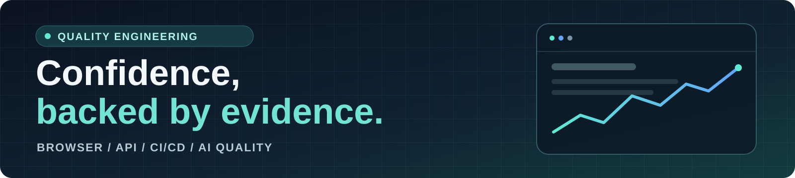

  

# Hi, I'm Carlos González

**Software Development Engineer in Test (SDET) · QA Automation · AI Quality** —
based in Spain.

I build test automation that turns product risk into **clear, actionable
evidence**. My focus is on thoughtful test design, maintainable checks and
fast feedback throughout CI/CD.

[LinkedIn](https://www.linkedin.com/in/carlos-gonzalez-2b33b6241/) ·
[Toolshop dashboard](https://carlosg-g.github.io/Toolshop-Hybrid-Automation/) ·
[AI Quality dashboard](https://carlosg-g.github.io/ai-quality-lab/)

## What I focus on

- **Quality strategy:** risk-based test design, defect analysis and traceable
  evidence that supports release decisions.
- **Test automation:** browser, API and contract checks built with TypeScript
  and Playwright, with independent verification where it adds value.
- **Delivery confidence:** CI quality gates, disposable test environments and
  reports that make results easier to understand.
- **AI quality:** testing RAG behavior, guardrails and evaluation workflows,
  with deterministic checks and optional model-assisted judging.

## Selected work

### [Toolshop Hybrid Automation](https://github.com/CarlosG-G/Toolshop-Hybrid-Automation)

**Risk-based automation · TypeScript · Playwright · Vibium**

A portfolio framework for a disposable e-commerce application, combining
browser journeys, API and OpenAPI contract checks, non-functional testing and
CI quality gates. The project includes test management, defect tracking and a
public evidence dashboard.

[Explore the repository](https://github.com/CarlosG-G/Toolshop-Hybrid-Automation) ·
[View the dashboard](https://carlosg-g.github.io/Toolshop-Hybrid-Automation/) ·
[Review the test plan](https://github.com/CarlosG-G/Toolshop-Hybrid-Automation/blob/main/docs/test-management/test-plan.md)

### [AI Quality Lab](https://github.com/CarlosG-G/ai-quality-lab)

**RAG testing · Evaluation · TypeScript · Playwright**

A hands-on lab for testing a RAG chatbot across unit, API and browser layers.
It combines guardrails and golden-case evaluations with deterministic CI and an
optional LLM judge. The public demo uses a mock provider.

[Explore the repository](https://github.com/CarlosG-G/ai-quality-lab) ·
[View the dashboard](https://carlosg-g.github.io/ai-quality-lab/) ·
[Explore the evaluations](https://github.com/CarlosG-G/ai-quality-lab/tree/main/evals)

## Toolbox

| Area                     | Tools and methods                                                                       |
| ------------------------ | --------------------------------------------------------------------------------------- |
| Languages and automation | TypeScript, Python, Playwright, Vibium, OpenAPI                                         |
| Quality techniques       | BDD, axe-core, OWASP ZAP, k6, Lighthouse, StrykerJS                                     |
| Delivery and evidence    | GitHub Actions, Docker, risk-based testing, ISTQB-aligned test management, traceability |
| AI quality               | RAG evaluation, guardrails, deterministic mocks, optional LLM judging                   |

## How I work with AI

I use AI coding agents as collaborators, with human review and reproducible
checks. Strategy, validation and accountability remain with me.

## Connect

Interested in quality engineering, test automation or AI testing?
[Let's connect on LinkedIn](https://www.linkedin.com/in/carlos-gonzalez-2b33b6241/).
